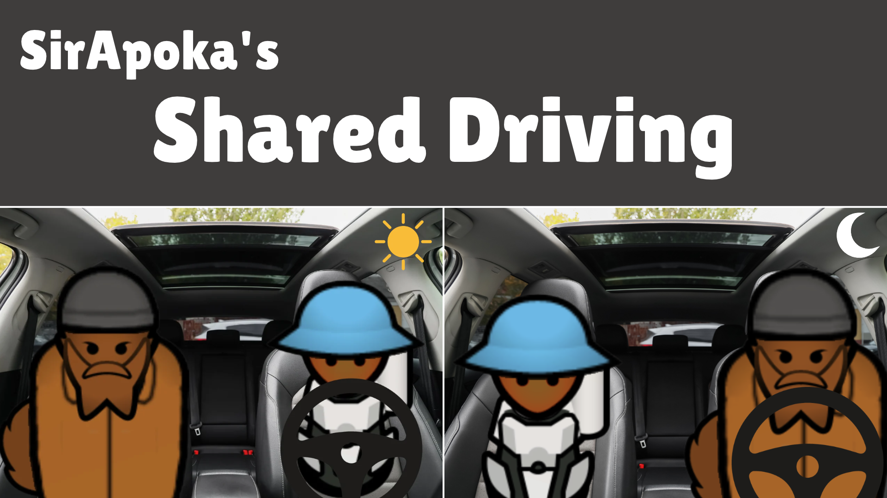

# Shared Driving



Team driving for [Vehicle Framework](https://steamcommunity.com/sharedfiles/filedetails/?id=3014915404) caravans. Drivers take turns, so the caravan keeps moving through the night. Requires [You Drive, I Sleep](https://steamcommunity.com/sharedfiles/filedetails/?id=3324430833).

## Why this exists

With You Drive, I Sleep, passengers sleep on the road, but my vehicle caravans still stopped every night because the driver needed rest, even when a passenger could have taken the wheel.

## What it does

Adds a "Shared driving" toggle to vehicle caravans. When it is on, each vehicle has a day driver and a night driver: the day driver drives from 6:00 to 18:00, the night driver from 18:00 to 6:00, and the other one sleeps in a passenger seat (handled by You Drive, I Sleep).

- The day driver is whoever is at the wheel during the day. The night driver is picked automatically (the most rested passenger who can operate the driver seat), or chosen per vehicle: right-click the toggle, use the seat assignment dialog, or put a pawn at the wheel during the night in the caravan's "Pawns" tab.
- Gunners stay at their turrets.
- The caravan still stops at night when someone travels outside the vehicles (on foot or riding), or when a vehicle has no passenger who can take over driving (for example a one-seat vehicle). You are notified when this happens.
- The "Rest" button still makes the caravan stop and rest.
- While the caravan can drive through the night, the estimated arrival time shows the non-stop travel time.
- Turning the toggle off puts every swapped driver back in their seat.
- Rearranging seats yourself is never undone: whoever you put at the wheel becomes the driver of the current shift, and the other one takes over at the next shift change.
- Seat assignment dialog: icons show who can drive or man the turrets of each vehicle (with the reason when not), and seat headers list their requirements.
- Caravan "Pawns" tab (where seats can be rearranged by dragging): the same icons above each seated pawn, a sun on the day driver and a moon on the night driver, and the requirements when hovering a seat header.
- Pawns in a vehicle's cargo (animals, mechs) rest while the caravan moves, like passengers do.

When the toggle is off, nothing changes: You Drive, I Sleep behaves as usual and the caravan rests at night.

Seat requirements come from Vehicle Framework's own checks, so mods that add requirements (such as Progression: Education's vehicle proficiency) are respected.

## Fixes for other mods

- Caravan "Pawns" tab: a vehicle's empty "Cargo" area is shown when an animal walks with the caravan, so it can be dragged into the cargo (Vehicle Framework only shows it when the cargo already holds a pawn).
- After loading a save, the "Cargo" section and the pawns in it show up again (Vehicle Framework does not rebuild that list on load).
- Progression: Education (optional): no more error when dropping a pawn onto a cargo area.

## Compatibility

- Requires Vehicle Framework and You Drive, I Sleep.
- Progression: Education is optional.
- With Comfortable Vehicles, also use [You Drive, I Sleep + Comfortable Vehicles Compatibility Patch](https://steamcommunity.com/sharedfiles/filedetails/?id=3845125160). Without it, nobody inside a vehicle rests while the caravan is stopped, so the "Rest" button would not help.

Every patch is applied separately. If one fails to apply (for example after a Vehicle Framework update), only that part is disabled and the log says which one. Log tag: `[Shared Driving]`.

## AI disclosure

This mod was coded with AI assistance. I directed the work, made the design decisions and tested it in my own game with about 500 mods.

## Requirements

- RimWorld 1.7
- Harmony
- Vehicle Framework
- You Drive, I Sleep

## Saves

Safe to add to an existing save. Before removing it, turn the toggle off on every caravan so drivers go back to their seats. Loading the save afterwards may log one error about the missing Shared Driving data, which can be ignored.

## Building

Requires the .NET 10 SDK, RimWorld 1.7 and Vehicle Framework installed. From `Source/`:

```
dotnet build -c Release
```

The project references the game's `Assembly-CSharp.dll` and Vehicle Framework's 1.7 assemblies directly. Set `RimWorldDir` and `VehicleFrameworkDir` if yours are elsewhere:

```
dotnet build -c Release -p:RimWorldDir="C:\Games\RimWorld" -p:VehicleFrameworkDir="C:\...\294100\3014915404\1.7\Assemblies"
```

The output is written to `1.7/Assemblies/`.

## License

[Creative Commons Attribution-NonCommercial 4.0 International (CC BY-NC 4.0)](LICENSE). You can share and adapt this mod for non-commercial purposes, as long as you credit SirApoka and indicate any changes.

Portions of the materials used to create this content/mod are trademarks and/or copyrighted works of Ludeon Studios Inc. All rights reserved by Ludeon. This content/mod is not official and is not endorsed by Ludeon.
